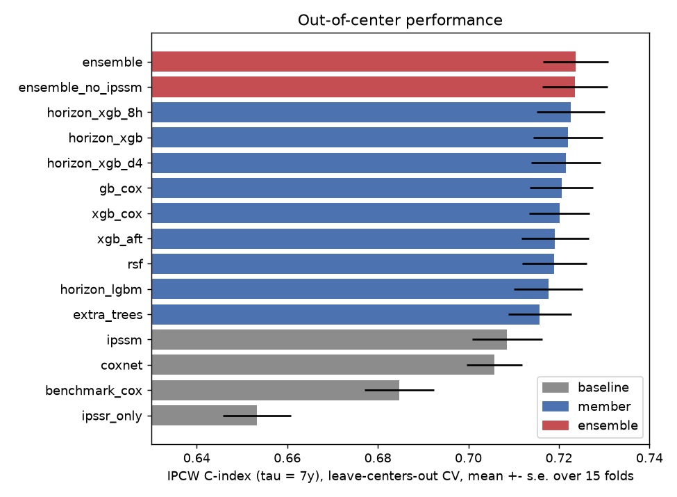
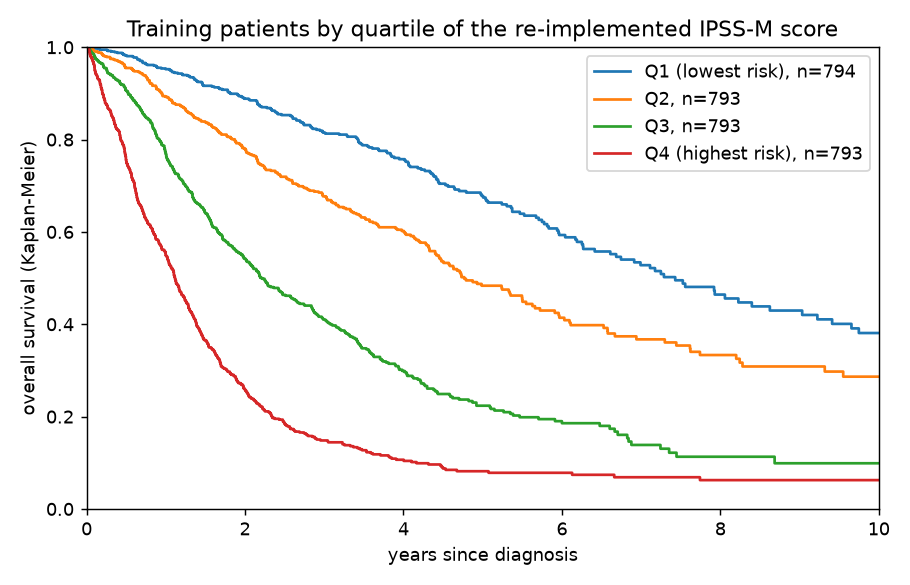

# qrt-leukemia-survival

[](https://github.com/lucaspaulien/qrt-leukemia-survival/actions/workflows/ci.yml)
[](LICENSE)

A risk model for **overall survival of adult myeloid leukemia patients**
(MDS / AML), built for the QRT x Gustave Roussy data challenge on
[challengedata.ens.fr](https://challengedata.ens.fr). Each patient comes with
blood counts, a free-text karyotype written by a cytogeneticist, and the list
of somatic mutations found by sequencing; the target is right-censored
survival time. The metric is Uno's **IPCW concordance index truncated at 7
years** -- only the *ranking* of patients by risk matters.

The single most important fact about this dataset is in its `CENTER` column:
the 3,173 labelled training patients come from **23 hospitals**, and **all
1,193 test patients come from a 24th one** (`KYW`) that never appears in
training. So the question is not "how well does the model fit these
hospitals" but "how well does it transfer to a hospital it has never seen",
and the whole validation is built around that.

## Headline result

Leave-centers-out cross-validation: 5 folds of *whole hospitals*, repeated
with 3 different random assignments of hospitals to folds (15 validation
folds), IPCW C-index at tau = 7 years with the censoring distribution
estimated on the training part of each fold. Real data,
`scripts/cross_validate.py`, raw numbers in `docs/cv_results.csv` (to keep
the run short, CV averages 3 seeds per boosted member and 1 per forest; the
submission uses 5 and 2):

| Model | C-index | Worst fold | Ensemble better on |
|---|---:|---:|---:|
| IPSS-R score alone (clinical standard, 2012) | 0.6533 | 0.609 | 15 / 15 folds |
| Organisers' benchmark (Cox on blasts, Hb, platelets, # mutations) | 0.6847 | 0.647 | 15 / 15 |
| Elastic-net Cox on all 224 features | 0.7058 | 0.675 | 15 / 15 |
| IPSS-M score alone (clinical + molecular standard, 2022), re-implemented | 0.7086 | 0.664 | 15 / 15 |
| Best single model: multi-horizon IPCW XGBoost | 0.7226 | 0.689 | 11 / 15 |
| **Ensemble** (rank average of 10 members) | **0.7238** | **0.690** | -- |

The ensemble beats every clinical score and linear baseline on every one of
the 15 held-out hospital groups (+0.039 over the benchmark, +0.015 over
IPSS-M on average), and edges out its best member on 11 of 15. Fold-level
C-indices range from 0.690 to 0.792: which hospitals you hold out matters more than which model you use, and the
three worst folds all contain the same center (GESMD, a Spanish MDS
registry), which is exactly the kind of shift the test center can bring.

<p align="center">
  
</p>

## Why leave-centers-out, and what it costs

A random stratified 5-fold on the same model (`scripts/ablation.py`) reports
**0.7246 +- 0.0033**; leave-centers-out reports **0.7220 +- 0.0077**. The
mean is only 0.0026 lower, but the uncertainty is more than twice as wide.
That width is the real information: centers differ in case mix (MDS-heavy
registries vs AML referral hospitals), in sequencing panels (from ~35 to
~100 distinct genes reported per center) and in follow-up length. A random
split averages these differences away and would have suggested a precision the
test set cannot deliver. It is also why every modelling choice below was
judged on the out-of-center score, not on fit.

## Features: putting hematology into the model

3,000 patients is not enough to rediscover decades of clinical research, so
most of the feature work (`src/amlrisk/`) re-encodes what hematologists
already know.

**Karyotype parsing** (`karyotype.py`). The `CYTOGENETICS` field mixes strict
ISCN (`46,xy,del(5)(q13q33)[18]/46,xy[2]`) with free text (`normal`,
`complex karyotype`, `no mitosis`). The parser splits clones on `/`, handles
`idem`, sex chromosomes, clone sizes, and extracts ~50 counts and flags:
number of abnormalities (in the most complex clone), monosomal karyotype,
complex (>= 3 / >= 4), and every lesion with known prognostic weight
(-5/del(5q), -7/del(7q), +8, del(20q), -Y, 17p, 3q26/inv(3), 11q23, t(8;21),
inv(16), t(15;17), t(9;22)...). It then maps each karyotype onto the five
**IPSS-R cytogenetic risk groups**.

**Molecular features** (`features.py`). Mutation burden, VAF summaries
(normalised: some centers report VAF in percent), a flag and max VAF for ~50
recurrently mutated myeloid genes, mutation counts for the genes where
multiple hits matter (TP53, TET2, ASXL1...), pathway burdens (splicing,
chromatin, signaling, methylation, transcription, cohesin, TP53), FLT3-ITD and
MLL-PTD.

**Clinical scores as features** (`prognostic.py`). The **IPSS-R** raw score
and the **IPSS-M** linear predictor (Bernard et al., 2022), including its
derived constructs: multi-hit TP53, SF3B1-alpha (favourable SF3B1 without
adverse co-mutations), SF3B1 + del(5q), capped count of residual genes.
IPSS-M on its own already reaches 0.7086 out of center -- a strong, fully
interpretable baseline that costs nothing to fit:

<p align="center">
  
</p>

## Models

`models.py` wraps every model behind the same `fit(X, y) / predict(X) -> risk`
interface. The families are chosen to disagree in how they treat time:

- **Proportional hazards**: XGBoost with Cox loss, scikit-survival gradient
  boosting with Cox loss (and an elastic-net Cox as a linear baseline).
- **Accelerated failure time**: XGBoost AFT with log-normal errors, where a
  censored patient is an interval `[t, +inf)`.
- **Non-parametric**: random survival forest, extremely randomised survival
  trees.
- **Discrete-time, multi-horizon** (`HorizonXGB`, `HorizonLGBM`): one binary
  classifier per horizon (0.5, 1, 2, 3, 5, 7 years) for "dead by year h".
  Patients censored before `h` have an unknown label and are dropped; the
  rest are reweighted by the inverse Kaplan-Meier probability of remaining
  uncensored up to `min(t, h)` (IPCW), so the labelled subset stands in for the
  whole cohort. The risk score is the mean over horizons of the rank of
  P(death by h). This makes **no proportional-hazards assumption** -- a
  feature may matter for early deaths and not late ones (high blast counts
  typically do) -- and it is the best single family here.

**Ensemble** (`ensemble.py`): every member is averaged over several seeds,
converted to ranks (members output a Cox log-hazard, a negated log-time, a
mean of probability ranks... on unrelated scales), and the ranks are averaged
with equal weights. IPSS-M enters as a member of its own; out of center, the
ensemble scores the same with or without it (0.7238 vs 0.7236).

## What was tried and dropped

Same leave-centers-out protocol, same model (multi-horizon XGBoost, 3 seeds),
`docs/ablation.csv`:

| Feature set | C-index |
|---|---:|
| **Base** (clinical + karyotype + molecular + IPSS-R/M, 224 columns) | **0.7220** |
| + extra biology (hotspots such as IDH2 R140 or SF3B1 K700E, TP53 DNA-binding domain / truncating / VAF > 40%, clonal architecture from VAF gaps, co-mutation pairs, blast x karyotype interactions) | 0.7206 |
| + within-center percentile ranks of the main continuous features (domain adaptation) | 0.7193 |
| + both | 0.7191 |

Both blocks fit better *within* the training centers and transfer worse to
unseen ones -- each extra column is another way to latch onto
hospital-specific patterns. They stay in the code (`extra_features`,
`center_ranks`) because the negative result is itself useful.

## Correctness: how this is verified

`pytest -v` (60 tests, all passing). The challenge data is not
redistributable, so the suite runs on hand-written karyotypes, hand-built
mutation tables and synthetic cohorts with a known risk structure:

- **`tests/test_karyotype.py`** -- IPSS-R cytogenetic categories on 13
  textbook karyotypes (from very good isolated -Y to very poor complex);
  multi-clone and `idem` handling; failed / missing karyotypes stay missing
  rather than being read as abnormal; 11q23 breakpoints whichever chromosome
  is written first.
- **`tests/test_prognostic.py`** -- IPSS-R at its two extremes (1 and 10);
  IPSS-M moves the right way for multi-hit TP53, NPM1, SF3B1-alpha vs SF3B1
  with RUNX1, and blasts.
- **`tests/test_features.py`** -- VAF rescaling, unmutated patients get zero
  counts but missing VAFs, special constructs (FLT3-ITD), train/test column
  parity.
- **`tests/test_validation.py`** -- folds never split a center, each patient
  is validated exactly once, folds are balanced and different seeds give
  different partitions; the C-index is ~1 for a perfect ranking, ~0 reversed,
  ~0.5 for noise; the horizon targets drop exactly the patients censored
  before `h`.
- **`tests/test_models.py`, `tests/test_end_to_end.py`** -- every model family
  gets within a few points of an oracle that knows the true log-hazard; the
  whole pipeline (CSV files in the challenge layout -> features ->
  leave-centers-out fold -> ensemble) ranks synthetic patients correctly.

Writing these tests found three bugs in the original parser, all fixed:
`45,x,-y` (the standard way of writing loss of Y, 159 patients) counted the
lesion twice and pushed isolated -Y out of the "very good" group; `failed` /
`no mitosis` were read as one abnormality instead of a missing karyotype;
and `t(9;11)(p22;q23)` -- the most common 11q23 rearrangement -- was missed
because 11 is written second.

## Project layout

```
qrt-leukemia-survival/
├── src/amlrisk/
│   ├── data.py          # loading the challenge files, feature matrices for modelling
│   ├── karyotype.py     # ISCN / free-text karyotype parser, IPSS-R cytogenetic groups
│   ├── features.py      # clinical + molecular features (+ the two dropped blocks)
│   ├── prognostic.py    # IPSS-R and IPSS-M re-implementations
│   ├── models.py        # Cox / AFT / forests / multi-horizon IPCW models
│   ├── ensemble.py      # members, seed averaging, rank blend
│   └── validation.py    # IPCW C-index, leave-centers-out folds
├── scripts/
│   ├── cross_validate.py    # headline table -> docs/cv_results.csv
│   ├── ablation.py          # validation-scheme and feature-block checks -> docs/ablation.csv
│   ├── plot_results.py      # docs/cv_scores.png, docs/km_ipssm.png
│   └── make_submission.py   # fit on all labelled patients, write submission.csv
├── tests/                   # 60 tests on synthetic data
└── docs/                    # figures and CSVs from the real-data runs
```

## Running it

The data is not redistributed. Download it from the challenge page and lay
it out as `data/X_train/{clinical,molecular}_train.csv`,
`data/X_test/{clinical,molecular}_test.csv` and `data/target_train.csv` (or
point `AMLRISK_DATA` / `--data-dir` elsewhere).

```bash
python -m venv .venv && source .venv/bin/activate
pip install -e ".[dev]"
pytest -v                                   # no data needed

python scripts/cross_validate.py            # ~15-20 min; --quick: one seed, ~2 min
python scripts/ablation.py                  # ~10 min
python scripts/plot_results.py
python scripts/make_submission.py --out submission.csv   # a few minutes
```

## Known limitations

1. **One test center, one draw.** The test set is a single hospital, so the
   leaderboard score is one sample from the spread of fold scores above
   (0.69 to 0.79). Nothing in the training data says where KYW falls.
2. **IPSS-M is approximate.** The official calculator imputes missing
   molecular variables by population averages; here an unreported gene is
   treated as wild type. Some centers' panels do not cover every IPSS-M gene,
   which biases their scores towards low risk.
3. **No treatment information.** Survival after diagnosis depends heavily on
   whether a patient was transplanted, which is not in the data; the model
   predicts prognosis under whatever treatment mix the training centers used.
4. **Equal ensemble weights.** Weights fitted on out-of-fold predictions
   (stacking) were not explored; with only 15 center-dependent folds to fit
   them on, they would be noisy at best.
5. **Hyperparameters set by hand** from a limited number of CV runs, not a
   systematic search.

## References

- Bernard, E. et al. (2022). *Molecular International Prognostic Scoring
  System for Myelodysplastic Syndromes*. NEJM Evidence, 1(7).
- Greenberg, P. L. et al. (2012). *Revised International Prognostic Scoring
  System for Myelodysplastic Syndromes*. Blood, 120(12), 2454-2465.
- Uno, H. et al. (2011). *On the C-statistics for evaluating overall
  adequacy of risk prediction procedures with censored survival data*.
  Statistics in Medicine, 30(10), 1105-1117.
- Ishwaran, H. et al. (2008). *Random survival forests*. Annals of Applied
  Statistics, 2(3), 841-860.
- Pölsterl, S. (2020). *scikit-survival: A Library for Time-to-Event Analysis
  Built on Top of scikit-learn*. JMLR, 21(212), 1-6.

## License

MIT. See `LICENSE`. The challenge data belongs to its organisers and is not
included.
